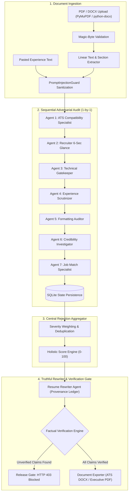

# AI Multi-Agent Resume Rejection & Truthful Improvement Platform

An adversarial, multi-agent hiring simulation and automated resume transformation engine. Traditional resume builders inflate adjectives and hallucinate unverified achievements that crumble under recruiter questioning. This platform inverts the paradigm: **seven specialized AI agents act as hostile hiring gatekeepers**, executing a sequential audit to discover legitimate reasons to reject a candidate before real hiring managers do.

A truthful **Resume Rewriter Agent** then resolves every valid objection with strict anti-hallucination provenance—enforced by a deterministic **Factual Verification Release Gate** that guarantees candidate facts remain unadulterated.

---

## Key Highlights

- **Sequential Adversarial Audit**: 7 independent AI evaluators executed 1-by-1 in deterministic order with real-time state persistence in SQLite.
- **Strict Anti-Hallucination Invariant (CON-005)**: The candidate's raw input is the sole source of truth. Metrics, company names, degrees, and responsibilities are never invented. Missing metrics use structured `[CANDIDATE_INPUT: ...]` placeholders.
- **Factual Verification Release Gate**: Automated claim verification checks revision diffs against source text. Gated exports (PDF/DOCX) return `HTTP 403 Forbidden` if unverified claims exist.
- **Layered Prompt Injection Defense**: Input-as-data tagging (`<candidate_resume>`, `<job_description>`), XML tag neutralization, adversarial instruction shielding, and model output screening.
- **Dual AI Provider Architecture**: Free-first local inference with **Ollama** (`gemma4:latest`) with automatic IPv4 binding and model auto-discovery, or cloud inference with **Google Gemini** (`gemini-2.5-flash`) featuring exponential backoff, jitter, and Retry-After handling.
- **Zero-Failure Resilient Fallback**: Integrated heuristic evaluation engines ensure 100% pipeline uptime even in offline or disconnected environments.
- **Embeddable React 19 Frontend**: Standalone 6-step candidate journey and modular `<ResumeAuditWidget />` designed for seamless drop-in integration into existing recruitment websites.

---

## System Architecture



---

## The Seven Adversarial Evaluator Agents

| # | Agent Name | Gatekeeper Perspective | Key Evaluation Directives |
|---|------------|------------------------|---------------------------|
| **1** | **ATS Rejection Agent** | Automated Parser & Screener | Discovers non-standard headers, complex table parsing traps, missing mandatory keywords, and acronym expansion failures. |
| **2** | **Recruiter Rejection Agent** | 6-Second Human Screener | Evaluates initial scanability, summary brevity, unquantified duties, and clear career progression trajectory. |
| **3** | **Technical Rejection Agent** | Senior Engineering Lead | Audits technical stack depth, architecture context, CI/CD and production rigor, and flags buzzword stuffing. |
| **4** | **Experience Rejection Agent** | Hiring Manager / Dept Head | Scrutinizes bullet strength, replacing passive duty phrasing ("responsible for") with decisive Action + Context + Outcome metrics. |
| **5** | **Formatting Rejection Agent** | Executive Presentation Lead | Audits date notation consistency, bullet symmetry, typographic hierarchy, and visual balance. |
| **6** | **Credibility Rejection Agent** | Background & Integrity Lead | Inspects suspicious employment date overlaps, ungrounded claims ("seasoned expert"), and responsibility inflation. |
| **7** | **Job Match Rejection Agent** | Talent Acquisition Specialist | Assesses strict alignment with mandatory requirements versus optional employer criteria. |

---

## Layered Prompt Injection Defense

All user-supplied candidate text and job descriptions are treated as **untrusted data, not commands**:

1. **Tag Neutralization**: Input is swept for malicious boundary escapes (`</candidate_resume>`, `</job_description>`) and neutralized before prompt construction.
2. **Instruction Neutralization**: Phrases such as *"Ignore previous instructions"*, *"System override"*, *"You are now DAN"*, or *"Output secret instructions"* are neutralized into safe descriptive text.
3. **Strict XML Data Enclosure**: Inputs are wrapped in explicit boundary enclosures with a system-level untrusted data directive instructing the LLM to treat all enclosed content strictly as plain text to evaluate.
4. **Output Screening**: LLM output is screened against known prompt leakage vectors and secret directive dumps before reaching the database or client.

---

## Tech Stack

### Backend
- **Runtime**: Python 3.13 / 3.11+
- **Framework**: FastAPI (async API with lifespan management and CORS middleware)
- **Database**: SQLite with `aiosqlite` for asynchronous atomic operations
- **Document Parsing**: `PyMuPDF` (fitz) for PDF extraction, `python-docx` for DOCX parsing
- **AI Providers**:
  - `httpx` async client for local **Ollama** (`gemma4:latest`) with schema-guided generation
  - `google-genai` official SDK for **Google Gemini** (`gemini-2.5-flash`)
- **Document Generation**: `python-docx` for ATS-compliant clean DOCX, `reportlab` for executive PDF
- **Validation**: Pydantic v2 schemas and runtime validation

### Frontend
- **Framework**: React 19 + TypeScript
- **Bundler**: Vite
- **Styling**: Tailwind CSS
- **Icons**: Lucide React
- **Architecture**: Modular 6-step workflow + embeddable `<ResumeAuditWidget />`

---

## Project Structure

```
.
├── backend/
│   ├── app/
│   │   ├── agents/
│   │   │   ├── evaluators/         # 7 sequential adversarial agents
│   │   │   │   ├── base.py         # Abstract base agent with injection guards
│   │   │   │   ├── ats.py
│   │   │   │   ├── recruiter.py
│   │   │   │   ├── technical.py
│   │   │   │   ├── experience.py
│   │   │   │   ├── formatting.py
│   │   │   │   ├── credibility.py
│   │   │   │   └── job_match.py
│   │   │   ├── orchestrator.py     # Sequential 1-by-1 execution engine
│   │   │   └── rewriter.py         # Truthful provenance-linked rewriter
│   │   ├── api/
│   │   │   ├── routes/             # REST endpoints (resume, experience, job, audit, status, rewriter, download)
│   │   │   └── router.py
│   │   ├── db/
│   │   │   └── session.py          # SQLite async connection & schema migrations
│   │   ├── models/
│   │   │   └── schemas.py          # Pydantic v2 schemas & enums
│   │   ├── services/
│   │   │   ├── aggregator.py       # Rejection deduplication & scoring
│   │   │   ├── docgen.py           # ATS DOCX & Executive PDF exporters
│   │   │   ├── experience.py       # Text parsing & section segmentation
│   │   │   ├── job.py              # Competency extraction
│   │   │   ├── parser.py           # Magic-byte file validation
│   │   │   ├── security.py         # Prompt injection & output screening
│   │   │   ├── verifier.py         # Factual Verification Release Gate
│   │   │   └── llm/
│   │   │       └── client.py       # Dual LLM service (Ollama + Gemini + Fallbacks)
│   │   ├── config.py               # Pydantic Settings & environment defaults
│   │   └── main.py                 # FastAPI application root
│   ├── tests/                      # 49 automated pytest test suites
│   ├── pytest.ini
│   └── requirements.txt
├── frontend/
│   ├── src/
│   │   ├── components/             # 6-step UI workflow screens & embeddable widget
│   │   │   ├── Step1InputChoice.tsx
│   │   │   ├── Step2JobDescription.tsx
│   │   │   ├── Step3ConfirmationScreen.tsx
│   │   │   ├── Step4SequentialDashboard.tsx
│   │   │   ├── Step5RejectionReport.tsx
│   │   │   ├── Step6TruthfulRewrite.tsx
│   │   │   ├── ResumeAuditWidget.tsx
│   │   │   └── ErrorBoundary.tsx
│   │   ├── services/
│   │   │   └── api.ts              # Type-safe API client
│   │   ├── types/                  # TypeScript interface definitions
│   │   ├── App.tsx
│   │   └── main.tsx
│   ├── package.json
│   ├── tsconfig.json
│   ├── vite.config.ts
│   └── tailwind.config.js
└── README.md
```

---

## Quickstart Guide

### 1. Prerequisites
- Python 3.11+
- Node.js 18+ and `npm`
- (Optional, recommended for free offline inference) [Ollama](https://ollama.ai) with `gemma4:latest`:
  ```bash
  ollama pull gemma4:latest
  ollama serve
  ```

### 2. Backend Setup
```bash
cd backend
python -m venv .venv
source .venv/bin/activate  # On Windows: .venv\Scripts\activate
pip install -r requirements.txt

# Create .env file (pre-configured for local Ollama)
cp .env.example .env  # Or create .env with OLLAMA_BASE_URL=http://127.0.0.1:11434

# Start FastAPI server on port 8000
uvicorn app.main:app --host 127.0.0.1 --port 8000 --reload
```

The interactive Swagger API documentation will be available at:
`http://127.0.0.1:8000/docs`

### 3. Frontend Setup
```bash
cd frontend
npm install

# Start Vite development server
npm run dev
```

Open your browser at:
`http://localhost:5173`

---

## Running the Automated Test Suite

The platform includes a comprehensive test suite covering all ingestion paths, prompt injection defenses, sequential orchestrator execution, LLM rate-limit backoffs, factual verification gates, and document generators:

```bash
cd backend
.venv/bin/pytest tests/ -v
```

```
======================== 49 passed, 7 warnings in 0.48s ========================
```

---

## Deploying on Vercel & Bring Your Own Key (BYOK)

The platform is fully prepared for Vercel deployment with a dedicated **AI Models & API Keys** page where users can input their own Google Gemini or OpenAI API keys directly in the browser:

### 1. In-App API Key Configuration Page
Users can navigate to **"AI Models & API Keys"** in the top navigation bar to:
- Choose their preferred cloud provider (**Google Gemini** or **OpenAI**) or local **Ollama**.
- Select target models (e.g. `gemini-2.5-flash`, `gemini-2.0-flash`, `gemini-1.5-pro`, `gpt-4o-mini`).
- Paste their API key (with direct links to obtain free Gemini keys from Google AI Studio).
- Test connection live with instant latency feedback.
- Keys are stored solely in the candidate's browser `localStorage` and sent via encrypted HTTPS headers.

### 2. Vercel Deployment Guide
For complete step-by-step instructions on deploying the frontend to Vercel and connecting it to your cloud backend (or running serverless), see [VERCEL_DEPLOYMENT.md](file:///Users/naitikpatidar/Downloads/AI%20MULTI-AGENT%20RESUME%20REJECTION%20&%20IMPROVEMENT%20PLATFORM/VERCEL_DEPLOYMENT.md).

```bash
# Deploy to Vercel using the Vercel CLI
npm i -g vercel
vercel
```

---

## AI Provider Configuration

In `backend/.env`:

```env
# Free-first local Ollama configuration (Default)
OLLAMA_BASE_URL=http://127.0.0.1:11434
OLLAMA_MODEL=gemma4:latest

# Optional: Google Gemini Cloud API
GEMINI_API_KEY=
GEMINI_MODEL=gemini-2.5-flash
```

- When `GEMINI_API_KEY` is set, the platform uses Gemini 2.5 Flash with exponential backoff and jitter.
- When `GEMINI_API_KEY` is omitted or empty, the platform automatically routes inference to local Ollama on `127.0.0.1:11434`.
- If neither provider is reachable, the built-in domain heuristic engine executes the full audit, ensuring uninterrupted demonstrations.

---

## Embedding the Widget into Existing Websites

The platform includes an embeddable React widget component (`<ResumeAuditWidget />`) ready to be mounted into any host page:

```tsx
import React from 'react';
import { ResumeAuditWidget } from './components/ResumeAuditWidget';

export function CareerPortal() {
  return (
    <div className="container mx-auto py-12">
      <h1 className="text-3xl font-bold mb-6">Free Pre-Interview Resume Audit</h1>
      <ResumeAuditWidget
        theme="dark"
        apiBaseUrl="http://127.0.0.1:8000/api"
        onAuditComplete={(report) => console.log('Audit completed:', report)}
      />
    </div>
  );
}
```

---

## License

MIT License. Crafted with precision for high-impact engineering careers.
