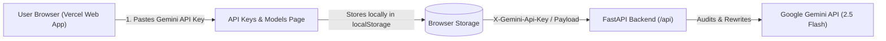

# Deploying to Vercel with Custom API Keys (BYOK)

This platform supports **Bring-Your-Own-Key (BYOK)** cloud inference. Users visiting your website can enter their personal **Google Gemini** (or **OpenAI**) API key on a dedicated web page to unlock live AI evaluation from all 7 adversarial hiring agents without requiring server-side API key configuration.

---

## Architecture Overview

---

## Deployment Options

### Option 1: Frontend on Vercel + Cloud Backend (Recommended)

This is the standard production architecture. The Vite + React 19 frontend is deployed on Vercel's global CDN, while the FastAPI backend runs on a container platform (such as Render, Railway, Fly.io, or AWS EC2).

#### Step 1: Deploy Backend (e.g. Render / Railway)
1. In your cloud provider dashboard, deploy from your GitHub repo using the `backend/` directory:
   - **Build Command**: `pip install -r requirements.txt`
   - **Start Command**: `uvicorn app.main:app --host 0.0.0.0 --port $PORT`
2. Note your backend URL (e.g., `https://my-backend.onrender.com`).

#### Step 2: Deploy Frontend on Vercel
1. Log in to [Vercel](https://vercel.com) and click **"Add New Project"**.
2. Select your repository.
3. In project settings:
   - **Framework Preset**: Vite
   - **Root Directory**: Select `frontend` (or keep root with `vercel.json`)
   - **Build Command**: `npm run build`
   - **Output Directory**: `dist`
4. In **Environment Variables**, add:
   - `VITE_API_BASE_URL`: `https://my-backend.onrender.com/api`
5. Click **"Deploy"**.

---

### Option 2: Full-Stack on Vercel (Serverless Monorepo)

The repository includes pre-configured root `vercel.json` and `api/index.py` allowing Vercel to host both the React frontend and Python FastAPI backend serverless functions.

1. Import the root of the repository into Vercel.
2. Vercel automatically detects:
   - `vercel.json` for frontend builds and route rewrites.
   - `api/index.py` as a serverless Python function (`@vercel/python`).
   - `requirements.txt` for Python dependencies.
3. **Serverless Compatibility Built-in**:
   - Automatic `/tmp/platform_data` SQLite redirection (bypassing read-only Lambda disk constraints).
   - Auto-advance agent execution (`run_next_agent_step`) prevents background task freezing across serverless requests.
4. Click **"Deploy"**.

---

## User API Key Configuration Page

Users visiting your deployed website can set up their AI models at any time:

1. Click **"AI Models & API Keys"** in the top navigation bar or the active status badge.
2. Select **Google Gemini** (Recommended) or **OpenAI**.
3. Choose the target model (e.g., `gemini-2.5-flash`, `gemini-2.0-flash`, `gemini-1.5-pro`, or `gpt-4o-mini`).
4. Paste the API key into the secure input field.
   - For Google Gemini: Click **"Get Free Key"** to open [Google AI Studio](https://aistudio.google.com/app/apikey) (Free tier with 15 requests per minute, no credit card required).
5. Click **"Test Connection / Verify Key"** to execute a live 1-token handshake and verify latency.
6. Click **"Save & Activate"** or **"Start Audit"**.

### Privacy & Security
- API keys are stored solely in the candidate's browser `localStorage`.
- Credentials are transmitted strictly over TLS/HTTPS headers (`X-Gemini-Api-Key`, `X-OpenAI-Api-Key`) to authenticate the session.
- Keys are never persisted in server logs or shared with third parties.
